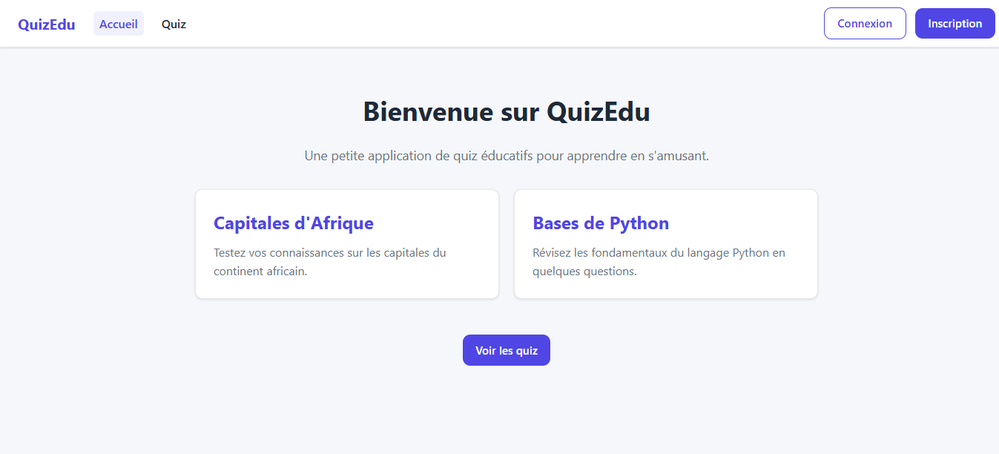
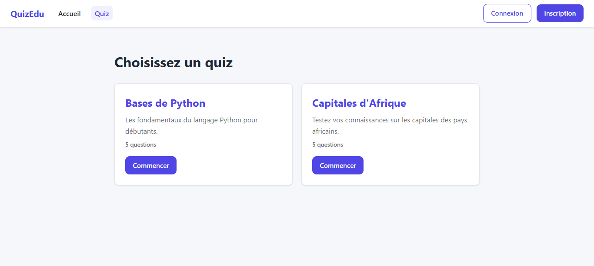
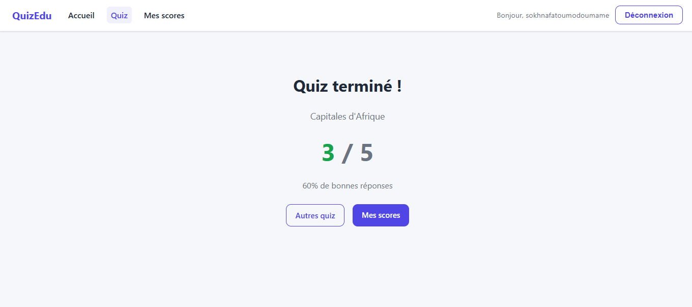

# QuizEdu — Application de quiz éducatifs

Application de démonstration (portfolio) : un petit site de quiz éducatifs
avec un backend **Django REST Framework** et un frontend **React (Vite)**,
orchestrés avec **Docker Compose**.

Données d'exemple fournies : « Capitales d'Afrique » et « Bases de Python ».

## Aperçu







---

## Sommaire

- [Démarrage rapide (Docker)](#démarrage-rapide-docker)
- [Démarrage sans Docker (développement)](#démarrage-sans-docker-développement)
- [Fonctionnalités](#fonctionnalités)
- [Schéma d'architecture](#schéma-darchitecture)
- [Technologies](#technologies)
- [Tests](#tests)
- [Intégration continue](#intégration-continue)
- [Structure du projet](#structure-du-projet)

---

## Démarrage rapide (Docker)

Prérequis : [Docker](https://www.docker.com/) avec le plugin Compose v2.

```bash
# 1. Copier la configuration d'exemple
cp .env.example .env

# 2. Lancer les trois services (PostgreSQL + backend + frontend)
docker compose up --build
```

Une fois démarré :

- Frontend : http://localhost:5173
- API backend : http://localhost:8000
- Admin Django : http://localhost:8000/admin (créez un super-utilisateur avec
  `docker compose exec backend python manage.py createsuperuser`)

Pour arrêter : `docker compose down` (ajoutez `-v` pour effacer la base).

---

## Démarrage sans Docker (développement)

### Backend

```bash
cd backend
python -m venv .venv
source .venv/bin/activate          # Windows : .venv\Scripts\activate
pip install -r requirements.txt

# En l'absence de POSTGRES_HOST, SQLite est utilisé automatiquement.
python manage.py migrate
python manage.py load_sample_data
python manage.py runserver
```

### Frontend

```bash
cd frontend
npm install
npm run dev
```

Le frontend attend l'API sur `http://127.0.0.1:8000` par défaut
(voir `frontend/.env.example`).

---

## Fonctionnalités

- **Authentification** : inscription et connexion par JWT
  (`/api/auth/register/`, `/api/auth/login/`, `/api/auth/me/`).
- **Liste des quiz** : `GET /api/quizzes/` (public).
- **Détail d'un quiz** (questions + choix) : `GET /api/quizzes/<id>/` (public).
- **Soumission des réponses** : `POST /api/quizzes/<id>/submit/` (authentifié),
  le score est calculé côté serveur.
- **Historique des scores** : `GET /api/quizzes/submissions/` (authentifié).
- **Frontend** : choisir un quiz, répondre question par question, voir son
  score et consulter son historique.

---

## Schéma d'architecture

```
┌──────────────┐     HTTP/JSON      ┌──────────────┐      SQL       ┌──────────────┐
│  Frontend    │  ───────────────> │   Backend    │  ──────────>  │  PostgreSQL  │
│  React/Vite  │  <─────────────── │  Django DRF  │  <──────────  │              │
│  (nginx)     │   REST + JWT      │  (gunicorn)  │               │              │
└──────────────┘                   └──────────────┘               └──────────────┘
   port 5173                          port 8000                     port 5432
```

Voir [`docs/ARCHITECTURE.md`](docs/ARCHITECTURE.md) pour le détail des choix
techniques.

---

## Technologies

| Couche        | Technologie                                   |
|---------------|-----------------------------------------------|
| Frontend      | React 19, Vite, React Router                  |
| Backend       | Django 4.2, Django REST Framework, SimpleJWT  |
| Base de données | PostgreSQL 16 (SQLite en fallback local)    |
| Conteneurisation | Docker, Docker Compose                    |
| Tests         | pytest, pytest-django                        |
| CI            | GitHub Actions                                |

---

## Tests

```bash
cd backend
python -m pytest -q
```

Les tests couvrent l'authentification (inscription, connexion, profil), la
liste et le détail des quiz, le calcul du score et l'historique.

---

## Intégration continue

Le workflow [`.github/workflows/ci.yml`](.github/workflows/ci.yml) s'exécute à
chaque push et sur chaque pull request :

- **Backend** : installation des dépendances et exécution des tests pytest.
- **Frontend** : installation des dépendances et build de production.

---

## Structure du projet

```
.
├── backend/                 # Django + DRF
│   ├── accounts/             # Auth (inscription, connexion, profil)
│   ├── quizzes/              # Quiz, questions, choix, soumissions
│   │   └── management/commands/load_sample_data.py
│   ├── quiz_project/         # Settings, urls
│   ├── Dockerfile
│   ├── entrypoint.sh
│   ├── requirements.txt
│   └── pytest.ini
├── frontend/                 # React + Vite
│   ├── src/
│   │   ├── api.js            # Client HTTP
│   │   ├── AuthContext.jsx   # Contexte d'authentification
│   │   ├── Navbar.jsx
│   │   ├── Home.jsx
│   │   ├── Login.jsx
│   │   ├── Register.jsx
│   │   ├── QuizList.jsx
│   │   ├── QuizDetail.jsx
│   │   └── History.jsx
│   ├── Dockerfile
│   └── nginx.conf
├── docs/
│   └── ARCHITECTURE.md
├── .github/workflows/ci.yml
├── docker-compose.yml
└── .env.example
```

---

## Licence

Projet de démonstration — voir [LICENSE](LICENSE).
